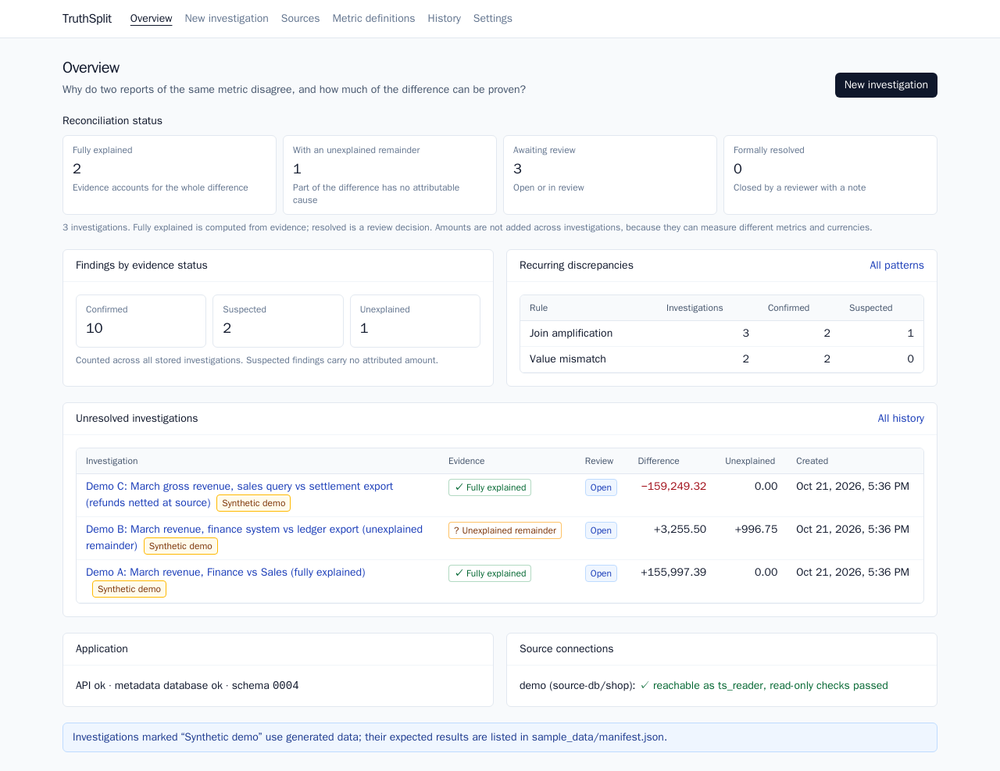
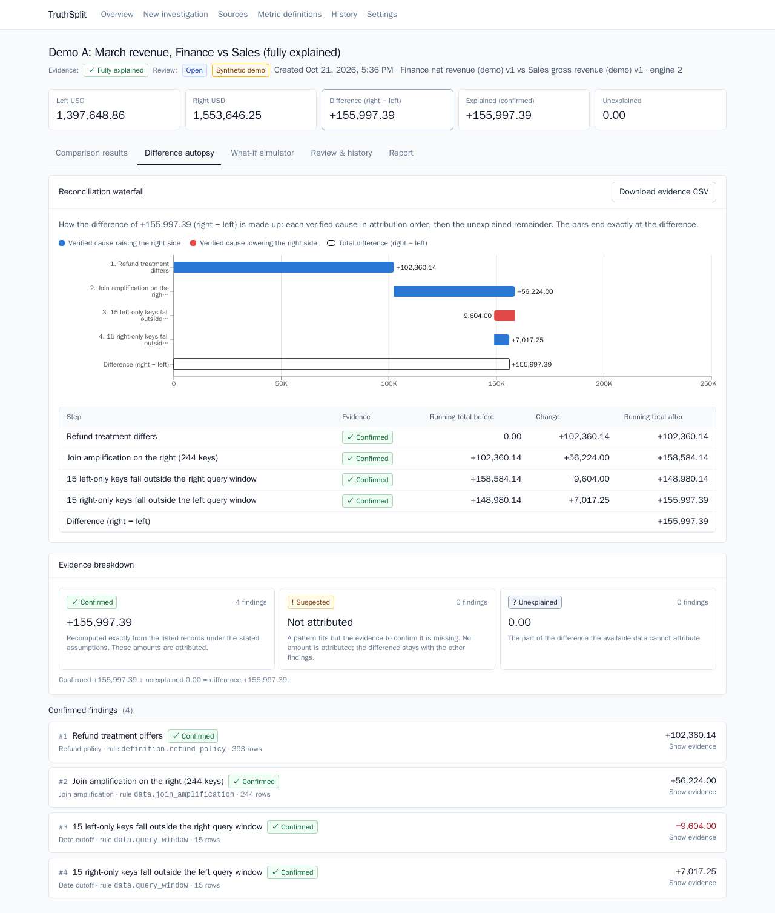
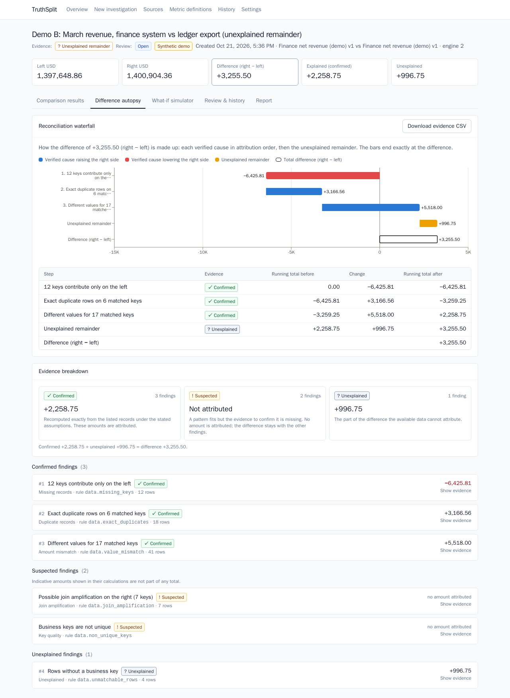
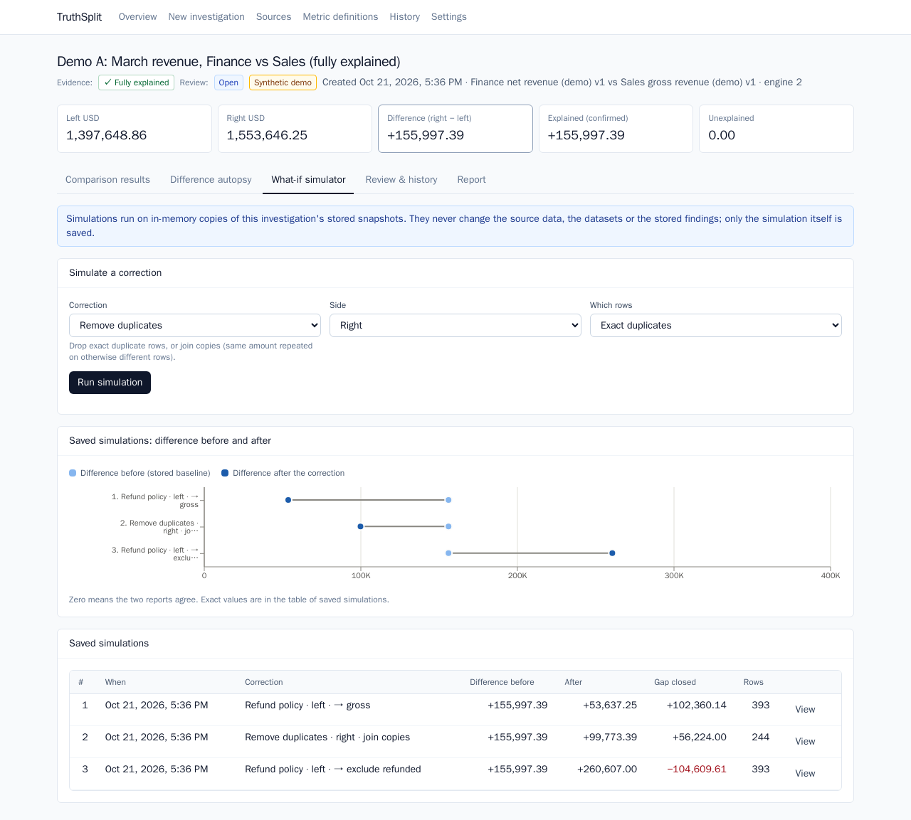
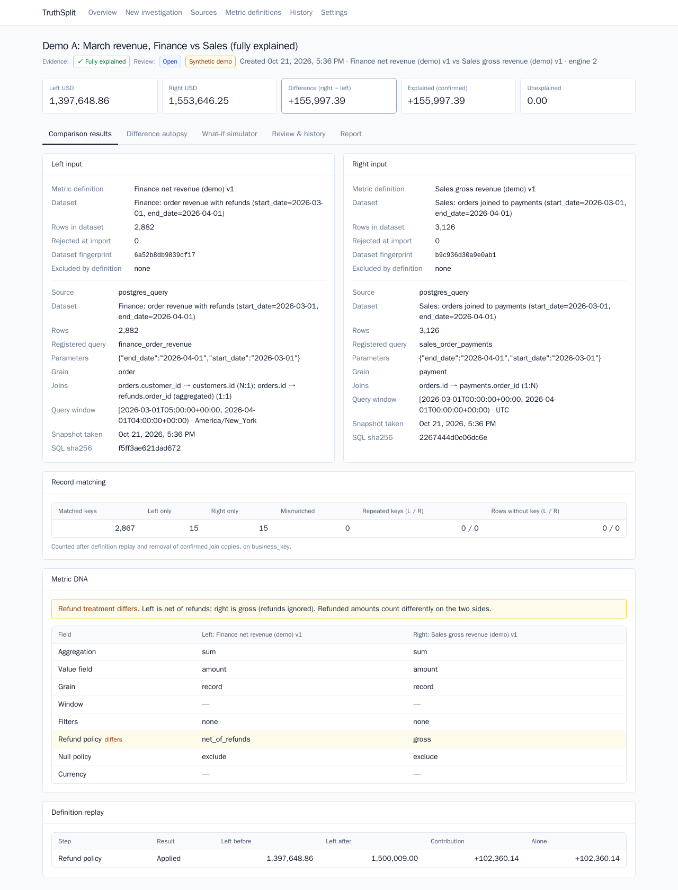
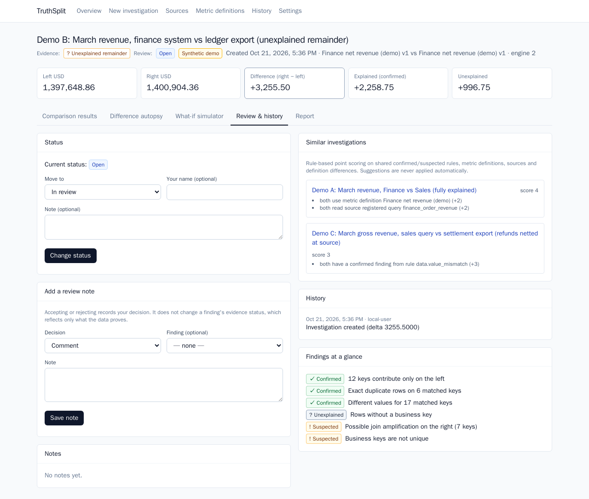
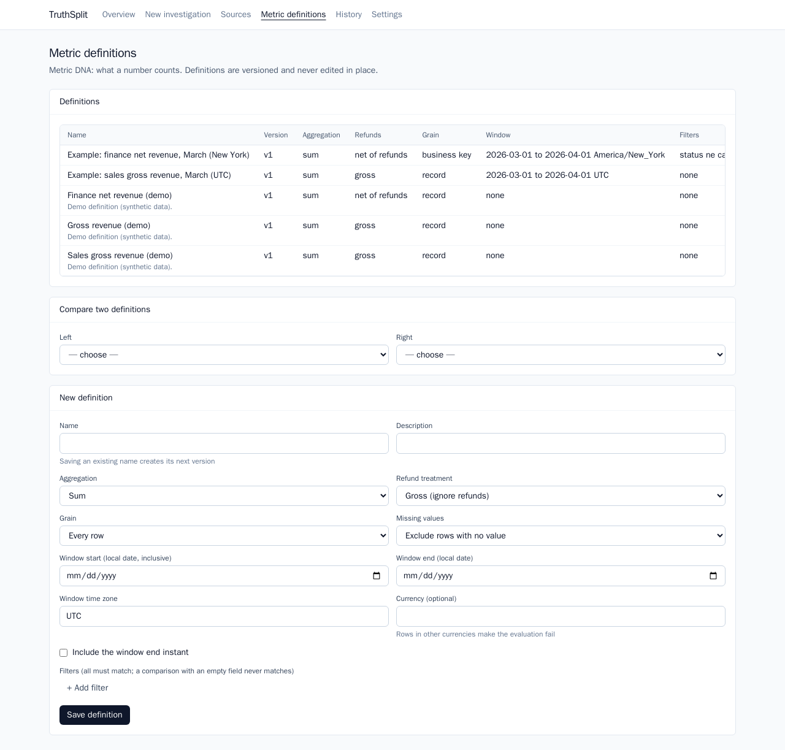
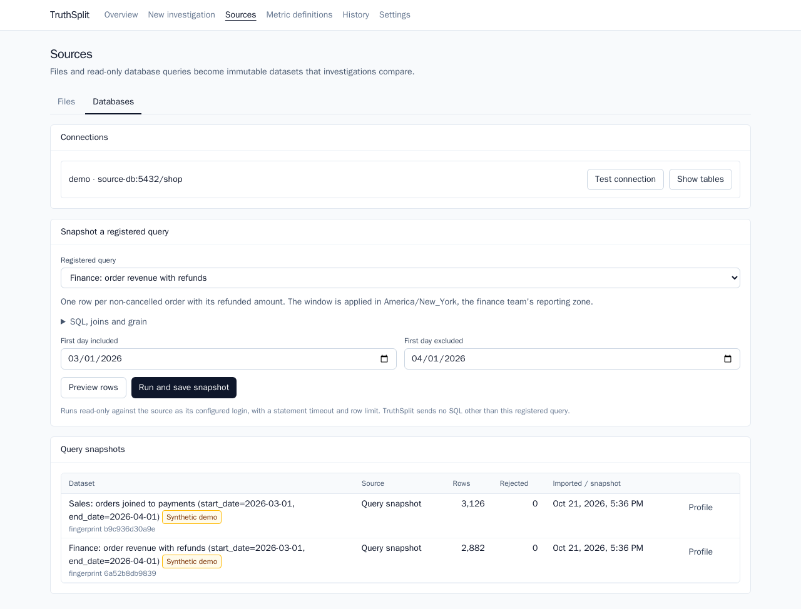
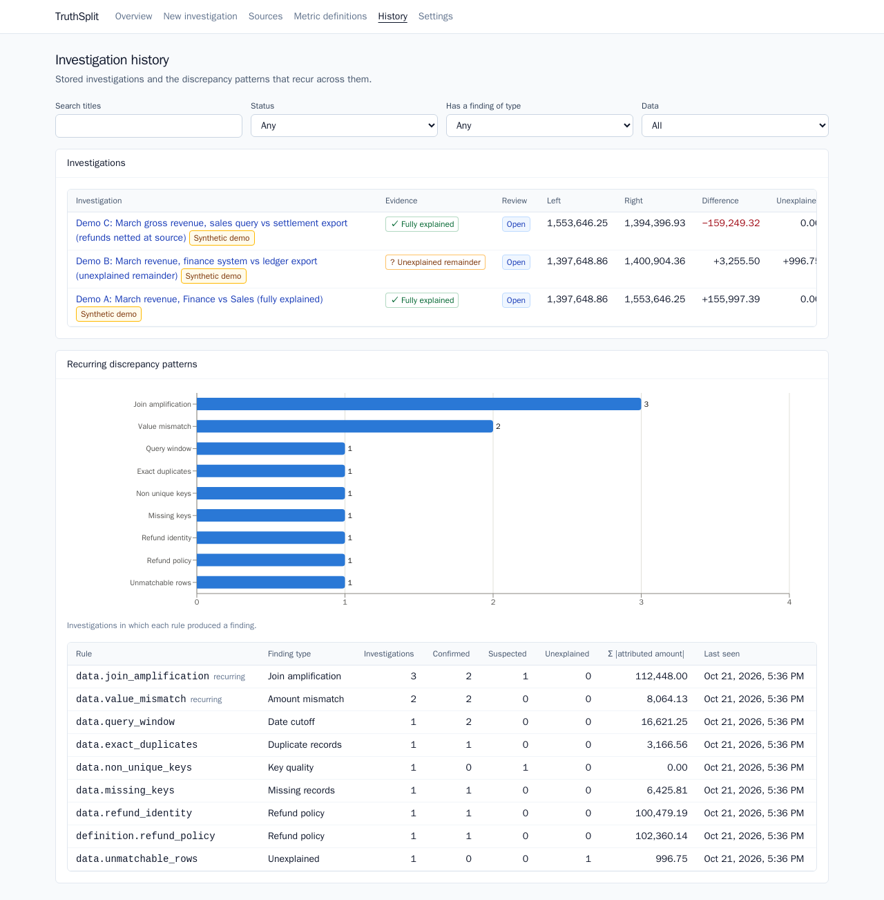
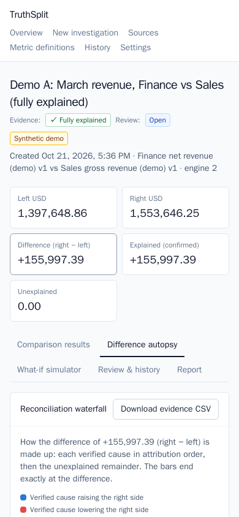

# TruthSplit

TruthSplit investigates why two reports of the same business metric disagree. It explains the gap between them with record-level evidence and reports whatever it cannot explain as an unexplained remainder.

**Status: in development.** In place so far: the Docker Compose stack, PostgreSQL schema and migrations, health checks, the file import API (CSV / XLSX / XLS upload, preview, column mapping, normalization), the comparison engine (metric definitions, record-level reconciliation, investigations with evidence), read-only PostgreSQL sources (registered queries snapshotted into datasets, so files and queries can be compared in any combination), the Difference Autopsy (definition replay, join amplification, cutoff and refund rules, evidence status), the what-if simulator and investigation memory (status workflow, resolution notes, audit history, recurring patterns, rule-based similar investigations). exportable reports (JSON, HTML, evidence CSV), and a React frontend for all of it, with Playwright end-to-end tests. CI, screenshots and the final documentation pass are not done yet.

## Running locally

Requires Docker with Compose v2.

```bash
scripts/generate_env.sh   # writes .env with random database passwords
docker compose up -d --build
```

| Service | URL |
|---|---|
| Frontend | http://localhost:5173 |
| API | http://localhost:8000 (`/health/live`, `/health/ready`, `/docs`) |
| Metadata database | `localhost:5433` |
| Demo source database | `localhost:5434`; the backend connects only as the read-only `ts_reader` role |

The backend container runs `alembic upgrade head` before it starts.

## File import API

| Method | Path | Purpose |
|---|---|---|
| `POST` | `/api/imports/file` | Multipart upload. Validates type, signature and size; returns sheet names and a preview with inferred column types. |
| `GET` | `/api/imports/{id}/preview?sheet=&encoding=` | Preview another worksheet or a CSV encoding. |
| `POST` | `/api/datasets` | Apply a column mapping and import normalized records. |
| `GET` | `/api/datasets`, `/api/datasets/{id}` | Datasets and their import summary. |
| `GET` | `/api/datasets/{id}/records`, `/api/datasets/{id}/issues` | Normalized records and rejected values, paginated. |
| `GET` | `/api/datasets/{id}/profile` | Aggregate statistics of the stored records (SQL over `dataset_records`). |

## Report API

| Method | Path | Purpose |
|---|---|---|
| `GET` | `/api/investigations/{id}/export?format=json\|html&download=true` | Full report: totals, inputs and fingerprints, Metric DNA, findings by evidence status with sample evidence, simulations, notes, history, recommended next steps, proof queries and limitations. The HTML is escaped, has no scripts and is served with a restrictive Content-Security-Policy. |
| `GET` | `/api/settings` | Limits and allowed hosts (no credentials). |
| `POST` | `/api/demo` | Load the demo investigations (idempotent). |

## Comparison API

| Method | Path | Purpose |
|---|---|---|
| `POST` / `GET` | `/api/metric-definitions` | Create the next version of a named metric definition; list definitions. |
| `GET` | `/api/metric-definitions/compare?left=&right=` | Metric DNA: two definitions side by side, with differences marked. |
| `POST` | `/api/investigations` | Evaluate two (dataset, definition) inputs, reconcile them and store the result. |
| `GET` | `/api/investigations`, `/api/investigations/{id}` | Stored investigations with totals, key statistics and findings. |
| `GET` | `/api/investigations/{id}/findings/{finding_id}/evidence` | Per-key evidence with source row numbers, paginated. |
| `GET` | `/api/investigations/{id}/evidence.csv` | All evidence rows as CSV. |

## Database sources

TruthSplit reads source databases only through **registered queries**: SQL defined in `backend/app/adapters/registered_queries.py`, with typed parameters. Users choose a query and supply parameter values; they can't submit SQL. Connections come from `TRUTHSPLIT_SOURCE_<NAME>_URL` environment variables, and the compose file defines `demo`, which points at the seeded `shop` database as `ts_reader`. Controls are described in [docs/security.md](docs/security.md).

| Method | Path | Purpose |
|---|---|---|
| `GET` | `/api/connections` | Configured sources (host and database only, never credentials). |
| `POST` | `/api/connections/{name}/test` | Connect and report the role's privileges. `ok` is false for any role that could write. |
| `GET` | `/api/connections/{name}/catalog` | Tables and columns the role may read. |
| `GET` | `/api/registered-queries` | Queries with their SQL, hash, parameters, tables, joins and grain. |
| `POST` | `/api/registered-queries/{key}/preview` | First 50 rows for the given parameters. |
| `POST` | `/api/registered-queries/{key}/snapshots` | Run the query and store its result as a dataset. |
| `POST` | `/api/datasets/{id}/freshness` | Re-run a snapshot's query and report whether the source data or the registered SQL has changed. |

Snapshots are ordinary datasets, so `POST /api/investigations` compares any two of CSV, XLSX, XLS and query snapshots. To reset the demo source data:

```bash
make seed-source
```

How differences are attributed, and what `confirmed`, `suspected` and `unexplained` mean, is in [docs/difference-autopsy.md](docs/difference-autopsy.md). Parsing and validation rules are in [docs/metric-contract.md](docs/metric-contract.md). Measured import times are in [docs/verification-report.md](docs/verification-report.md).

## Simulation and memory API

| Method | Path | Purpose |
|---|---|---|
| `POST` / `GET` | `/api/investigations/{id}/simulations` | Apply one correction to in-memory copies and re-run the autopsy; nothing but the simulation record is written. |
| `PATCH` | `/api/investigations/{id}/status` | open, in_review, resolved, archived (resolving needs a note). |
| `POST` / `GET` | `/api/investigations/{id}/notes` | Accept or reject a finding, or comment. |
| `GET` | `/api/investigations/{id}/history` | Audit trail. |
| `GET` | `/api/investigations/{id}/similar` | Rule-based similar investigations with reasons, and accepted diagnoses from them as suggestions. |
| `GET` | `/api/memory/patterns` | Recurring finding types and rules across investigations. |

Details are in [docs/simulation-and-memory.md](docs/simulation-and-memory.md).

## Demo

```bash
make demo
```

This loads three **synthetic** investigations into the running stack: one fully explained by refund treatment, join duplication and reporting cutoffs; one with an unexplained remainder; and one where a source reports amounts already net of refunds. Their expected results are in [`sample_data/manifest.json`](sample_data/manifest.json), computed independently of the engine; see [sample_data/README.md](sample_data/README.md).

## Screenshots

Captured from the running application with the synthetic demo data (`make screenshots`).

| | |
|---|---|
|  | **Overview:** fully explained vs unexplained remainder (from evidence) shown apart from review status, findings by evidence status, recurring discrepancies. |
|  | **Difference Autopsy, demo A:** the reconciliation waterfall from 0 to the difference (+155,997.39) through refund treatment, join amplification and two cutoffs. |
|  | **Demo B:** confirmed causes, an unexplained remainder of 996.75, and suspected findings that carry no amount. |
|  | **What-if simulator:** saved simulations as before → after differences (one widens the gap). |
|  | **Comparison results:** inputs, record matching, Metric DNA, definition replay. |
|  | **Review and history:** status, notes, audit trail, rule-based similar investigations. |
|  | **Metric definitions:** versioned definitions and Metric DNA comparison. |
|  | **Sources:** connection tests, registered queries, snapshots. |
|  | **History:** filters and recurring discrepancy patterns. |
|  | **Phone width (390px).** |

## Frontend

React, TypeScript, Vite, Tailwind CSS and Recharts, served at http://localhost:5173 by the compose stack. Every page reads from and writes to the API; there is no mock data.

| Page | What it does |
|---|---|
| Overview | Fully explained vs with remainder (evidence), awaiting review vs formally resolved (review), findings by evidence status, recurring discrepancies, unresolved investigations, API and source health, demo loader. Amounts are never summed across investigations. |
| New investigation | Wizard. Each side is an existing dataset, an uploaded file (preview, sheet, encoding, column mapping) or a registered-query snapshot. Then pick or create metric definitions, with a live Metric DNA comparison. |
| Sources | File upload and import; per-dataset profile (keys, duplicates, amount and refund statistics, time range, currencies, statuses, attributes, rejected values by column); connection tests, catalog, registered-query preview and snapshot, freshness checks. |
| Metric definitions | Versioned definitions; comparison that states each difference in plain language (refund treatment, aggregation, grain, filters, date window in local time and UTC) above the full side-by-side table; form for new versions. |
| Investigation | Header shows **Evidence** (fully explained / unexplained remainder, computed) separately from **Review** status (open, in review, resolved, archived; set by a person). Tabs: comparison results (inputs, record matching, Metric DNA with plain-language differences, definition replay); Difference Autopsy (reconciliation waterfall with a running-totals table, evidence breakdown by confirmed / suspected / unexplained, finding cards with calculations and paginated supporting records, CSV download); What-if simulator (before → after chart of saved simulations, per-rule comparison); review and history; report (sandboxed HTML preview, JSON/HTML/CSV downloads). |
| History | Filters by title, status, finding type and demo flag, plus a recurring-pattern chart and table. |
| Settings | Limits and safety settings in effect; no credentials. |

Money is shown from the API's exact decimal strings and never converted to floating point for display. Charts use numbers only for bar lengths, and every chart has a table with the exact values. Demo data is labelled "Synthetic demo" wherever it appears.

To check the frontend build (type check plus production build) in a Node container:

```bash
make frontend-check
```

## End-to-end tests

Requires the stack to be running. Runs Playwright in its official container on the compose network:

```bash
make e2e
```

The tests cover:
- every page loading without console errors, and no horizontal overflow at 375px on every page and investigation tab;
- a file investigation: validation, upload and mapping, run, evidence, simulation that leaves the baseline unchanged after a reload, and report download;
- an investigation of two database query snapshots, whose expected difference is read from the demo manifest;
- review notes persisting across a reload;
- the reconciliation waterfall for demos A, B and C: step amounts equal the manifest, running totals add up exactly (BigInt), the last equals the difference;
- evidence-breakdown totals, evidence vs review status staying separate after a formal resolution, the before/after chart listing every saved simulation, the dataset profile against values computed from the CSV, Metric DNA difference statements and Overview KPIs.

`make screenshots` re-captures `docs/screenshots/`.

## Backend tests

Requires Python 3.12+ and the compose databases running.

```bash
make backend-venv
make test
make lint
```

Tests that need a database are skipped unless `TRUTHSPLIT_TEST_DATABASE_URL` is set; `make test` sets it. The test database (`truthsplit_test`) is created on the compose `db` service and is reset by the test run.
