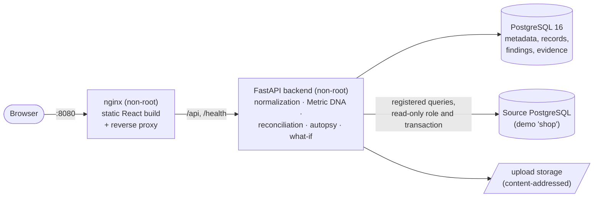

# TruthSplit

[](https://github.com/saxipatel/truthsplit/actions/workflows/ci.yml)

**Evidence-based metric reconciliation.** TruthSplit explains why two reports of the same business metric disagree. It attributes the gap to concrete causes (definition differences, duplicated joins, reporting cutoffs, refund treatment, missing and extra records) and backs every amount with the source records that produce it. Whatever it cannot prove is reported as an **unexplained remainder**, never hidden.

**Stack:** Python, FastAPI, PostgreSQL, SQLAlchemy and Alembic on the backend; React and TypeScript on the frontend; Docker Compose with nginx; tested with pytest and Playwright in GitHub Actions.


## Why

"Finance says March revenue was 1.40 M, Sales says 1.55 M." Both numbers are usually correct for their own definition. Reconciling them by hand means:
- exporting both sides;
- guessing at definitions;
- matching records in a spreadsheet;
- ending with a "close enough" explanation that nobody can check.

TruthSplit makes that process repeatable and auditable:

- **Exact.** All money is `Decimal` end to end, from file parsing to database (`numeric`) to API (decimal strings) to UI (string formatting, BigInt addition). Totals reconcile to the cent.
- **Additive.** The confirmed causes plus the unexplained remainder always sum exactly to the difference. The engine asserts it on every run.
- **Evidence over guesses.** A cause is either **confirmed** (amount proven from records), **suspected** (plausible, no amount claimed) or **unexplained**. There are no confidence percentages.
- **Read-only by design.** Source databases are read only through registered, parameterized queries, in read-only transactions, with roles that cannot write.

## Features

| Area | What it does |
|---|---|
| **Sources** | CSV, XLSX and XLS upload: signature checks, encoding and sheet selection, preview with inferred types, column mapping, rejected values kept with row and reason. Read-only PostgreSQL **registered queries** snapshotted into immutable datasets, with freshness checks. Files and queries compare in any combination. |
| **Metric DNA** | Versioned metric definitions (aggregation, value field, grain, filters, date window and time zone, refund policy, null policy), compared side by side with each difference stated in plain language. Each definition is also rendered as SQL, and that "proof query" is checked against the Python result. |
| **Reconciliation** | Per-business-key matching: missing, extra, amount mismatch, exact duplicates, records without a key. |
| **Difference Autopsy** | Ordered replay of definition differences (date window, filters, refund policy, grain, null policy, value field), with standalone amounts and overlap notes. Data rules: join amplification (confirmed only with declared 1:N join metadata), query-window cutoffs, refund identity. Reconciliation waterfall, evidence breakdown, paginated supporting records, CSV export. |
| **What-if simulator** | Apply one correction (remove duplicates, align window, refund policy or definition, adjust mapping) to in-memory copies, re-run the autopsy, and compare before → after. Stored data is never changed. |
| **Review and memory** | Review workflow (open, in review, resolved, archived), kept separate from evidence status. Accept or reject notes per finding, audit history, recurring patterns, and rule-based similar investigations with their accepted diagnoses. |
| **Reports** | JSON and self-contained HTML (escaped, no scripts, restrictive CSP) with inputs and fingerprints, Metric DNA, findings, evidence samples, simulations, notes, history, proof SQL and limitations. |
| **Synthetic demo** | Three investigations whose expected results were computed independently of the engine (`sample_data/manifest.json`): fully explained; unexplained remainder; refunds netted at source. |

## Architecture



Module map, investigation pipeline and the database ER diagram: [docs/architecture.md](docs/architecture.md).

| Layer | Technology |
|---|---|
| Backend | Python 3.12, FastAPI, SQLAlchemy 2, Alembic, psycopg 3, openpyxl and defusedxml, xlrd |
| Database | PostgreSQL 16 (metadata) and a separate PostgreSQL 16 demo source |
| Frontend | React 18, TypeScript, Vite 6, Tailwind CSS 4, Recharts, React Router 7 |
| Serving | nginx 1.30 (unprivileged image): static build, gzip, immutable asset caching, security headers |
| Tests | pytest (unit and integration against real PostgreSQL), Playwright (end to end against the production stack) |
| CI | GitHub Actions: backend, frontend build, end to end, security (gitleaks, bandit, pip-audit, npm audit) |

## Quick start

Requirements:
- Docker with Compose v2.
- Python 3 (standard library only) to run the verification and benchmark scripts.

Node and a backend virtualenv are needed only for development.

```bash
git clone https://github.com/saxipatel/truthsplit.git && cd truthsplit
scripts/generate_env.sh                 # writes .env with random passwords (mode 600, git-ignored)
docker compose up -d --build --wait     # builds and starts db, source-db, backend, frontend
```

Open **http://localhost:8080** and click **Load demo investigations** on the Overview page, or:

```bash
make demo          # load the three synthetic investigations
make verify-demo   # check them against sample_data/manifest.json
```

| Service | Address |
|---|---|
| Web UI (nginx) | http://localhost:8080 (`WEB_PORT`) |
| API, OpenAPI docs | http://localhost:8000/docs; health at `/health/live` and `/health/ready` |
| Metadata database | `localhost:5433` |
| Demo source database | `localhost:5434`; the backend connects only as the read-only `ts_reader` role |

All ports bind to 127.0.0.1. The backend runs `alembic upgrade head` on start. Stop with `docker compose down`; add `-v` to delete the data volumes.

**Frontend development** with hot reload (Vite on http://localhost:5173, proxying the API):

```bash
docker compose -f docker-compose.yml -f docker-compose.dev.yml up -d --build
```

## Demo workflow

1. **Overview → Load demo investigations.** This creates three synthetic investigations, labelled "Synthetic demo" everywhere they appear.
2. **Demo A (fully explained).** Finance 1,397,648.86 vs Sales 1,553,646.25, a difference of +155,997.39. The waterfall breaks it down: refund treatment +102,360.14, join amplification +56,224.00, and two time-zone cutoffs (−9,604.00 and +7,017.25). The remainder is 0.00. Open a finding to see its calculation, its proof SQL and the exact records behind it.
3. **Demo B (unexplained remainder).** Finance vs a ledger export: +3,255.50. Missing records, amount mismatches and duplicate exports are confirmed, and 996.75 stays unexplained. A possible join amplification is listed as suspected, without an amount, because no join metadata proves it.
4. **Demo C (refunds netted at source).** A sales query vs a settlement export: −159,249.32. Three causes explain it fully: join copies (−56,224.00); refunds netted by the settlement, found by the refund identity, where a per-key difference equals that key's refund to the cent (−100,479.19); and amount mismatches (−2,546.13).
5. **What-if tab.** In demo A, remove the join copies on the Sales side and the difference shrinks by exactly the join-amplification amount (56,224.00). The simulation is saved; the investigation is not changed.
6. **Review tab.** Accept a finding with a note and set the status to resolved. The evidence label (fully explained / unexplained remainder) stays separate from the review status.
7. **Report tab.** Download the HTML or JSON report, or the evidence CSV.
8. **Your own data.** Use **New investigation**: upload two files (or snapshot a registered query), map the columns, choose or create metric definitions and run.

The demo files are in [`sample_data/`](sample_data/README.md), and you can upload them yourself.

## Screenshots

Captured from the running application with the synthetic demo data (`make screenshots`).

| | |
|---|---|
|  | **Overview:** evidence (fully explained vs unexplained remainder) shown apart from review status, findings by evidence status, recurring discrepancies. |
|  | **Demo B:** confirmed causes, an unexplained remainder of 996.75, and suspected findings that carry no amount. |
|  | **What-if simulator:** saved simulations as before → after differences. |
|  | **Comparison results:** inputs and fingerprints, record matching, Metric DNA, definition replay. |
|  | **Review and history:** status, notes, audit trail, similar investigations. |
|  | **Metric definitions:** versioned definitions and Metric DNA comparison. |
|  | **Sources:** connection test, registered queries, snapshots. |
|  | **History:** filters and recurring discrepancy patterns. |
|  | **Phone width (390 px).** |

## Testing

```bash
make backend-venv && make lint && make test   # ruff, then pytest (needs the compose databases)
make frontend-check                           # tsc + production build in a Node container
make e2e                                      # Playwright in its official image, against the running stack
make verify-demo                              # the three demos against sample_data/manifest.json
```

- **Backend:** unit tests for parsing, mapping, metric evaluation, matching, the autopsy and the what-if simulator. Integration tests against real PostgreSQL for:
  - the API;
  - Python ↔ SQL parity of metric definitions;
  - the read-only source controls (privileged roles refused, write attempts failing, timeouts, row limits);
  - uploads;
  - the demos;
  - reports.
- **End to end:** every page without console errors or horizontal overflow at 375 px, a complete file investigation, database snapshots, review persistence, and the waterfall, evidence breakdown and profile checked against independently computed values.

### Verified results (Milestone 8, fresh clone, 2026-10-22)

| Suite | Passed | Failed | Skipped | Warnings |
|---|---:|---:|---:|---:|
| Backend (pytest, Python 3.12 and 3.14) | 330 | 0 | 0 | 1 (third-party deprecation) |
| End to end (Playwright 1.56.1, production nginx build) | 20 | 0 | 1 (screenshot capture, opt-in) | 0 |
| Demo reproduction (`make verify-demo`) | 36 checks | 0 | 0 | 0 |
| Frontend type check and build | pass | | | |

**Continuous integration.** The first GitHub Actions run on `main` ([run #1](https://github.com/saxipatel/truthsplit/actions/runs/39805064485), commit `b86f84d`) passed all four jobs: backend (lint and 330 tests), frontend (type check and build), security (gitleaks, bandit, pip-audit, npm audit) and end to end (36/36 demo checks, 20 Playwright tests passed, 1 opt-in skipped) against the production Docker stack.

Details, including the defects found and fixed along the way, are in [docs/verification-report.md](docs/verification-report.md).

## Performance

Measured through the HTTP API on a fresh stack (Apple M4, Docker Desktop, one Uvicorn worker). Median of 3 runs, with every run's findings checked against the differences planted in the generated data:

| Rows per side | Import (one file) | Investigation | What-if simulation | Profile |
|---:|---:|---:|---:|---:|
| 10,000 | 0.39 s | 0.17 s | 0.20 s | 0.05 s |
| 100,000 | 2.23 s | 1.74 s | 2.31 s | 0.25 s |
| 250,000 (the row limit) | 5.37 s | 4.56 s | 6.00 s | 0.52 s |

Backend peak memory over the whole run: 824 MiB. Method, environment and limits are in [docs/benchmarks.md](docs/benchmarks.md); reproduce with `python3 scripts/benchmark.py`.

## Security

| Area | Controls |
|---|---|
| Database access | Only registered SQL with typed, bound parameters runs; users cannot submit SQL. Before connecting: host allowlist, then role privileges inspected (refused if the role can write, create or escalate). The query runs in a `READ ONLY` transaction with statement and lock timeouts and a row limit. |
| Credentials | Environment variables only; the database stores a profile name. Errors are sanitized. |
| Uploads | Extension and signature checks, streaming size cap (nginx 30 MB, API 25 MB), row limit, defusedxml for XLSX, macro-enabled files refused. |
| Web | Strict Content-Security-Policy, `nosniff`, frame and referrer policies, non-root containers, 127.0.0.1-only ports. |
| CI checks | gitleaks, bandit, pip-audit, npm audit, plus Dependabot. |

The full threat model, the test that covers each control, the scan results and the known limitations are in [docs/security.md](docs/security.md).

### Security warnings

- **No authentication, rate limiting or TLS.** TruthSplit is a single-user local tool and every port binds to 127.0.0.1. Do not expose it on a network without an authenticating reverse proxy that terminates TLS.
- **The database role is the real guarantee.** Configure sources only with roles that cannot write. TruthSplit refuses to query a role that can, but that role's credentials would still be present in the environment.
- **A role can change its own session defaults.** `ALTER ROLE <self> SET default_transaction_read_only = off` succeeds for any role. It grants no write access, and TruthSplit always runs read-only transactions.
- **Local credentials are only as safe as `.env`.** Generate them with `scripts/generate_env.sh`; do not reuse the placeholder values in `.env.example`.
- **The upstream PostgreSQL image.** Trivy reports Go standard-library advisories in the `gosu` binary of `postgres:16-alpine`. It runs only at container start to drop privileges and makes no network connections. Accepted; see [docs/security.md](docs/security.md).
- **Image scanning is manual.** Trivy is not part of CI; gitleaks, bandit, pip-audit and npm audit are.

## Limitations

- **Single-user local tool.** No authentication or rate limiting; do not expose it beyond localhost without an authenticating proxy and TLS.
- **Single currency per comparison.** No FX conversion; mixed currencies are refused rather than summed.
- **Database connectors.** PostgreSQL is the only one, and new registered queries are added in code (`backend/app/adapters/registered_queries.py`), not through the UI.
- **Size limits.** Up to 250,000 rows per dataset (`TRUTHSPLIT_MAX_ROWS`) and 25 MB per upload. Investigations run in memory in the API process.
- **Join amplification needs metadata.** It is confirmed only when the query declares a 1:N join; otherwise it is reported as suspected, without an amount.
- **Similarity is rule-based.** Points come from shared confirmed or suspected rules, metric names, sources and Metric DNA differences; it is not a learned model.
- **Snapshots are not refreshed automatically.** Use the freshness check.
- **Benchmarks are from one machine.** They were measured on an Apple M4 laptop with Docker Desktop and a single API worker; concurrency was not tested. See [docs/benchmarks.md](docs/benchmarks.md).
- **Builds are not fully pinned.** Python dependencies are lower bounds without a lock file, and Docker base images are referenced by tag, not digest; the frontend and e2e npm dependencies are locked.
- **Recharts 2.x is deprecated upstream.** No advisory affects it today, but an upgrade to v3 is pending.
- **No dark theme.**

## Documentation

| Document | Contents |
|---|---|
| [docs/architecture.md](docs/architecture.md) | Components, backend modules, investigation pipeline, ER diagram |
| [docs/metric-contract.md](docs/metric-contract.md) | Normalized record contract: parsing, validation, precision, time zones |
| [docs/difference-autopsy.md](docs/difference-autopsy.md) | Attribution order, rules, evidence statuses |
| [docs/simulation-and-memory.md](docs/simulation-and-memory.md) | What-if rules, review workflow, patterns, similarity |
| [docs/security.md](docs/security.md) | Threat model, controls and the tests that verify them, scans |
| [docs/verification-report.md](docs/verification-report.md) | Per-milestone verification with measured results |
| [docs/benchmarks.md](docs/benchmarks.md) | Benchmark method, environment and measured results |
| [sample_data/README.md](sample_data/README.md) | How the synthetic demo data and its expected results are produced |
| [DECISIONS.md](DECISIONS.md) | Design decisions, alternatives and trade-offs |
| [LEARNING_GUIDE.md](LEARNING_GUIDE.md) | Walkthrough of the code, a reading order and exercises |

## Project structure

```
truthsplit/
├── backend/
│   ├── app/
│   │   ├── adapters/        # file reading, PostgreSQL read-only access, registered queries
│   │   ├── api/             # FastAPI routers
│   │   ├── comparison/      # metric evaluation, key matching, proof SQL
│   │   ├── diagnosis/       # Metric DNA, Difference Autopsy
│   │   ├── simulation/      # what-if engine
│   │   ├── memory/          # patterns, similarity, review
│   │   ├── reporting/       # JSON/HTML reports
│   │   ├── normalization/   # column mapping, value parsing
│   │   ├── db/ models/ schemas/ core/
│   │   └── seed/            # independent demo model and loader
│   ├── migrations/          # Alembic 0001–0004
│   └── tests/               # unit/ and integration/
├── frontend/
│   ├── src/                 # pages/, features/, components/, api/, lib/
│   ├── nginx/               # production server config and security headers
│   ├── Dockerfile           # production: Node build → nginx
│   └── Dockerfile.dev       # Vite dev server
├── e2e/                     # Playwright tests
├── docker/source-db/        # demo source database: read-only role, seed
├── sample_data/             # synthetic demo files and expected results
├── scripts/                 # generate_env.sh, verify_demo.py, benchmark.py
├── docs/                    # architecture, contracts, security, verification, screenshots
├── .github/                 # CI workflow, Dependabot
├── docker-compose.yml       # production-style local stack
└── docker-compose.dev.yml   # frontend dev-server override
```

## Development

AI-assisted development tools were used during implementation. The project includes documented architecture, engineering decisions, automated tests, and reproducible verification procedures.

## License

[MIT](LICENSE) © 2026 TruthSplit contributors.
