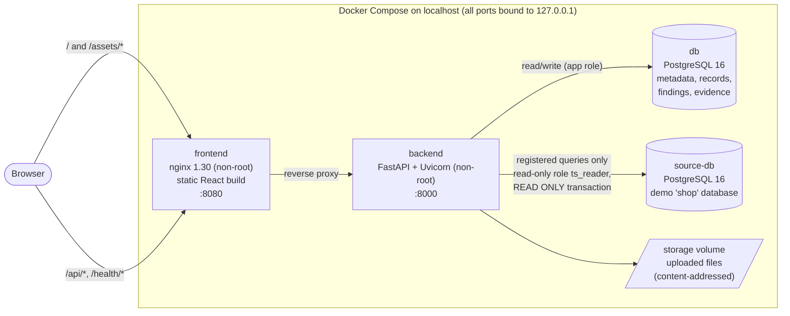
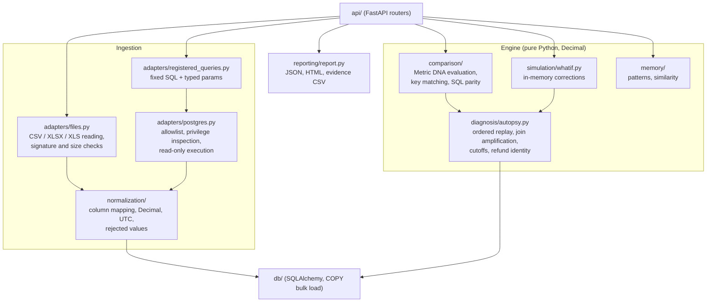
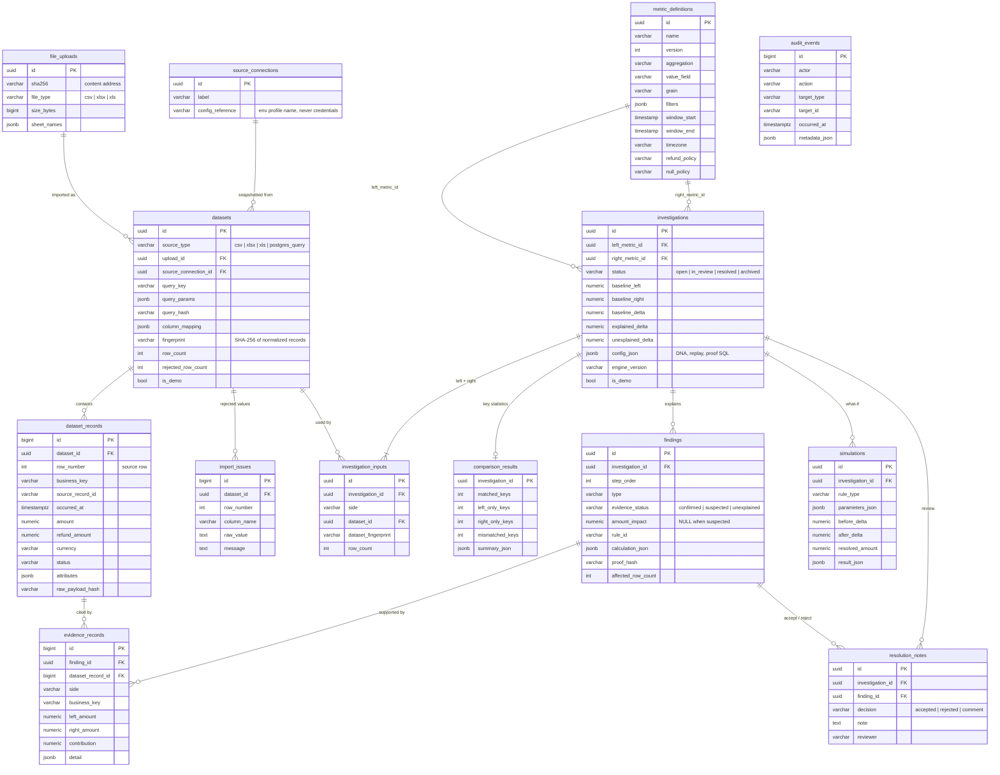

# Architecture

## Components

The browser talks to one origin. nginx serves the compiled frontend and proxies `/api/` and `/health/` to the backend, so there is no CORS configuration. For frontend development, `docker-compose.dev.yml` swaps nginx for the Vite dev server on port 5173.

## Backend modules

An investigation runs in this order:

1. Load both datasets' records.
2. Evaluate each side's Metric DNA: window → filters → refund policy → grain → null policy → aggregation.
3. Reconcile per business key: extra, missing, duplicate, mismatch, no key.
4. Run the Difference Autopsy:
   - replay the definition differences in a fixed order, attributing each step's change;
   - apply the data rules;
   - check that the confirmed amounts plus the unexplained remainder sum exactly to the difference.
5. Store findings with record-level evidence and proof SQL.

## Database (metadata)

Schema created by Alembic migrations `0001`–`0004` (`backend/migrations/versions/`). Amounts are `numeric(18,4)` per record and `numeric(24,4)` for totals and evidence; timestamps are `timestamptz` in UTC.

`audit_events` refers to its target by type and id rather than a foreign key, so the history outlives the rows it describes. Every column of every table is listed in the migrations; the diagram leaves out timestamps and a few descriptive columns.
